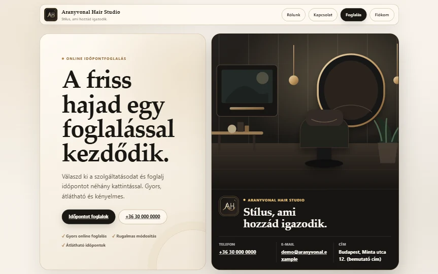
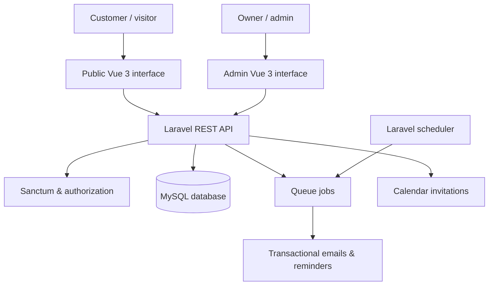
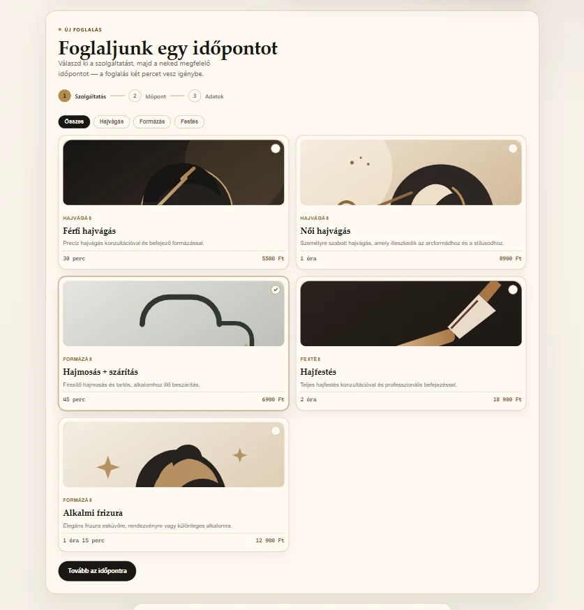
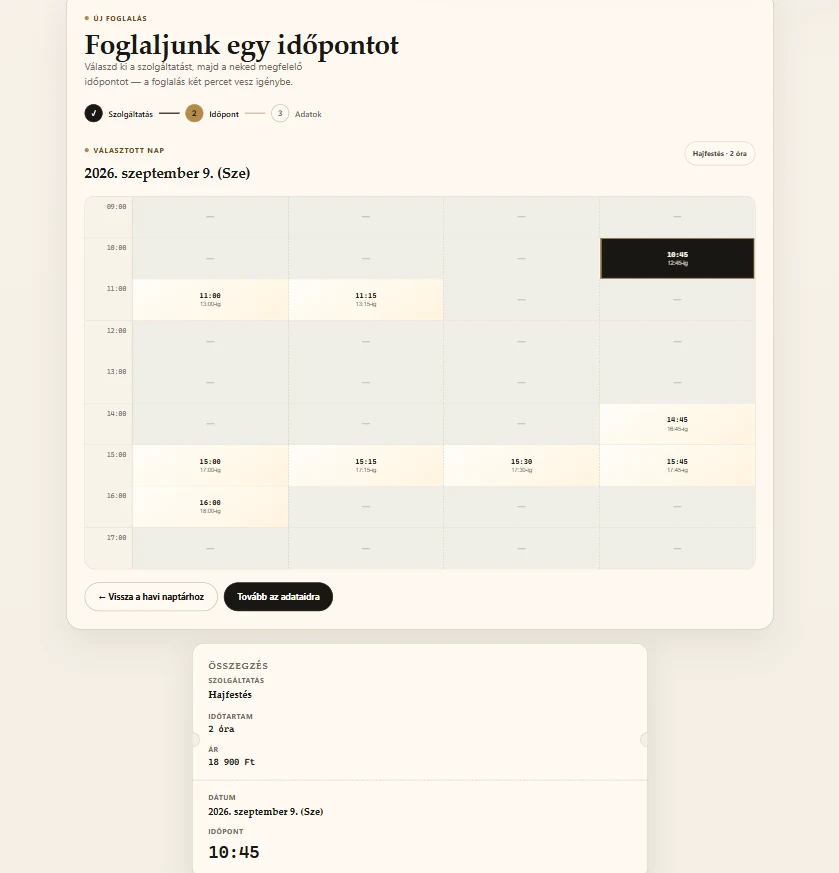
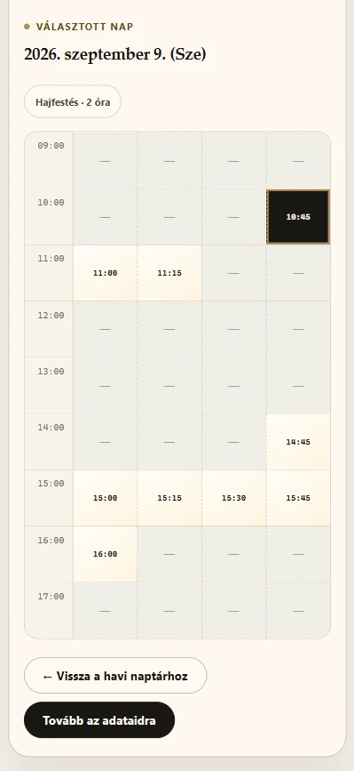
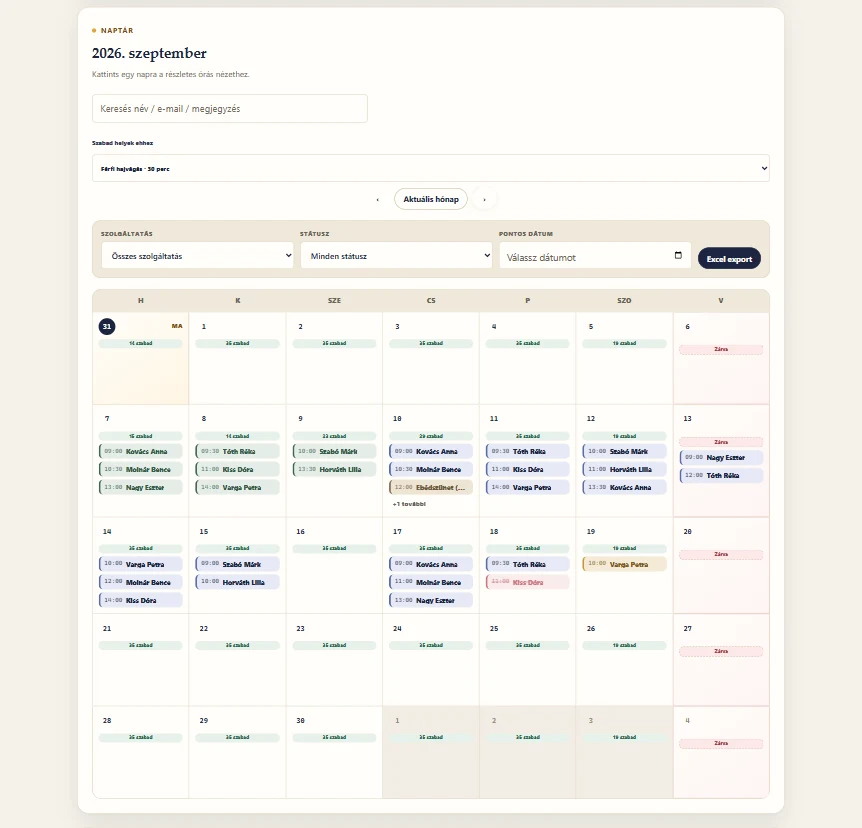
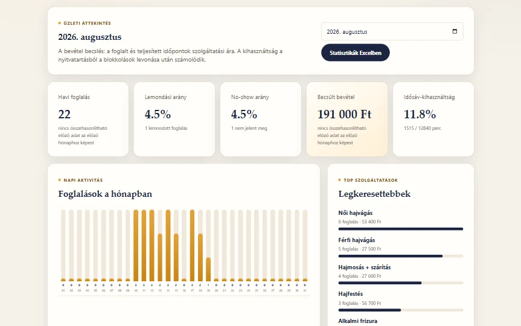

# Appointment Platform — Full-Stack Case Study

**A booking and business administration platform for service-based businesses.** Designed, developed, tested and deployed as a real-world product, with a public demonstration and a **private commercial codebase**.

[**Live product site**](https://olcsikaszbusiness.hu/) · [**Try the demo**](https://olcsikaszbusiness.hu/demo) · [**GitHub profile**](https://github.com/OlcsikaSZ)

> **Portfolio showcase, not an open-source release.** The complete application, production configuration, business logic and deployment repository are private. This public repository contains selected screenshots, a high-level architectural overview and limited source-code excerpts.

## The product

Appointment Platform combines a branded business website, customer-facing online booking and an owner/admin dashboard. The demonstration is styled as **Aranyvonal Hair Studio**, a fictional salon using demonstration data.

| For customers | For business owners |
| --- | --- |
| Browse services, duration and pricing | View and manage bookings in calendar views |
| See available appointments | Configure services, hours, exceptions and blocked periods |
| Book on desktop or mobile | Create bookings and manage statuses |
| Change or cancel a booking through a secure link | Track customer history, email logs and statistics |
| Receive confirmations, reminders and calendar invitations | Manage website content and review basic reports |

The system also supports optional customer accounts, scheduled email reminders and data-retention workflows.

## Technologies

| Layer | Technology |
| --- | --- |
| API & backend | **PHP 8.2+**, **Laravel 12**, REST API |
| Authentication | Laravel Sanctum, scoped API access and role checks |
| Frontend | **Vue 3**, JavaScript, HTML, CSS; build-free frontend distribution |
| Database | **MySQL** (Laravel migrations) |
| Background processes | Laravel queue jobs and task scheduler |
| Testing | PHPUnit/Laravel feature tests, Node.js frontend smoke tests |
| Deployment | Linux shared hosting, SSH, Git, rsync and scripted checks |

## Architecture (simplified)

*Conceptual diagram of the main application components. Not a network or deployment-security blueprint.*

## Engineering highlights

- **Scheduling rules:** server-side availability considers opening hours, service duration, buffers, existing bookings and blocked periods.
- **Data separation:** business-scoped queries and authorization controls are backed by feature tests that check cross-business access.
- **Safer account workflows:** scoped access tokens, registration/password-management controls, and time-limited booking-management links.
- **Asynchronous notifications:** confirmations, cancellations, changes, reminders and calendar invitations are integrated into the booking lifecycle.
- **Operational readiness:** Git-based releases, pre-deployment checks, backups, logging and production routines were considered alongside feature development.
- **Responsive UI:** the same flow supports desktop and narrow mobile screens.

## Screenshots

| Public website & service selection | Desktop booking flow |
| --- | --- |
|  |  |

| Mobile booking flow | Administration calendar |
| --- | --- |
|  |  |

**Reporting and statistics**

All screenshots show demonstration content, not real customer records.

## Selected source excerpts

The complete commercial application is **not** included. These carefully selected excerpts illustrate actual code from the private project without publishing the core booking engine:

- [`code-samples/PersonName.php`](code-samples/PersonName.php) — Laravel validation rule handling Unicode letters and common punctuation in personal names.
- [`code-samples/AdminSecurityTest.excerpt.php`](code-samples/AdminSecurityTest.excerpt.php) — a selected PHPUnit feature test checking that an admin cannot access resources belonging to another business.

The excerpts depend on framework/project classes and **are not a standalone runnable application**. They are intended for code review and discussion in interviews. Further code can be demonstrated live during an interview, where appropriate.

## Testing & release practices

The private repository includes booking-flow, account security, role isolation, email, reminder and administrative feature tests, as well as frontend smoke checks. Its production deployment workflow verifies the branch, working tree and repository hygiene, checks the GitHub revision, and deploys the approved release through SSH to the hosting environment.

These are descriptions of the implemented workflows; this showcase does not contain the private tests, CI credentials or deployment automation required to reproduce production locally.

## My role

End-to-end development: system structure, database design, backend API, frontend experience, automated checks, deployment and ongoing technical improvements. The project is also a commercial product initiative under **Olcsi Business**.

## Magyar összefoglaló

Az **Appointment Platform** egy saját fejlesztésű, online időpontfoglaló és vállalkozáskezelő webalkalmazás. Laravel 12 / PHP backenddel, Vue 3 frontenddel és MySQL adatbázissal készült. Tartalmaz mobilbarát foglalást, adminnaptárt, ügyfélfiókokat, e-mailes értesítéseket, statisztikákat és automatizált teszteket. A rendszer működő demója megtekinthető a [bemutató oldalon](https://olcsikaszbusiness.hu/demo). A teljes forráskód üzleti okokból privát, itt a szakmai referenciához szükséges, megosztható anyagok találhatók.

---

**Copyright © 2026 Olcsi Business. All rights reserved.** This repository is published for portfolio evaluation only. No open-source license or permission to reuse, redistribute, resell or deploy these assets and excerpts is granted. Third-party dependencies in the private application remain subject to their respective licenses.
